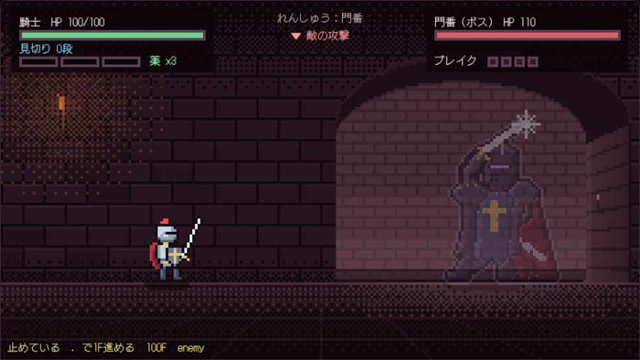

# 2026-11-25 ゲーム（js/）

開発者ページの「敵を半透明」と「止める」で、門番の二連撃の1撃目を100Fで止めたところ。合図が剣先に出ているのが体の重なりごしに読める。

## したこと
- 開発者ページに「見え方」（背景を消す・敵や主人公を半透明・光と粒を消す・文字と枠を消す）と「止める」（`.` で1Fずつ進める）を足した。モーションと合図をコマで確かめられる。
- 数値の台帳とコードのずれを見るテストを入れ、どこからも読まれていなかった【岩の巨人：最後のゴンから当たるまでのフレーム】を外した。台帳と同じ `P` を使っていた3ファイルの名前を改めた。
- ゲームへの依頼31節に進み具合の一覧を作った（途中10・まだ20・決まり1、済みは0）。一覧と節がずれるとテストが落ちる。
- 敵27体を自動で戦わせ、例外・HPのくずれ・詰みを探すテストを入れた。check.sh では約11秒。種を変えて約7.5時間ぶん回し、こわれ方はなかった。
- 日報（このフォルダ）と判断待ちの一覧（`tools/handan.mjs`）を作った。「まだ」の20節の進め方を Ibuki が決め、新しい技を別のエージェントが遊びごたえで見直した（99の技とモーションのうち、外す22・まとめる9。11-26に Ibuki がつばめ返しとひまなときを戻し、外すは18になった）。

## 決めたこと
- 「まだ」の20節は全部やる。進め方は判断シートの問1〜6を全部案Aで決めた（中身は `design/GAME_REQUESTS.md` の「入れ方」）。新しい技は、別のエージェントのレビューで遊びごたえにほとんど貢献しないものを外してから入れる。11-26：つばめ返しは二連撃と間をずらして残す、三つ首の首のすり替えは外す、ひまなときは全部遊び心として残す。外すと判断された18のうち9を戻し（足元の溜まり・二つの高さ・触手の檻・水面の先読み・アーチが閉じる・あごの触手・指歩き・触手の合・突きのフェイント）、外すは8になった（水の中の無音の居合も残す）。まとめる9は全部まとめる。打ち合いのモーションは多いほど面白いので減らさない。チケットはリポジトリの中に1枚1ファイルで持つ（2023-04-11「チケットでタスク管理」）。「まだ」の20節を47枚に切った。床に埋まるの定義も決めた（「床と間合い」の節）。
- 並んで作業するセッションは、触るファイルを始めに決め、自分の変更だけをコミットする（CLAUDE.md）。
- 依頼の状態は 済み・途中・まだ・保留・やめた・決まり の6つ。

## 困ったこと
- 「済み」が0で「途中」が10。手を広げたまま閉じていない。改善案：新しい節に入る前に、残りがいちばん小さい「途中」（見た目・演出の門番まわりなど）を1つ済みまで持っていく。
- このセッションからは GitHub に push できず、パッチで渡した。改善案：ゲームの作業は push できる Claude Code のセッションで行う。

## 決めてほしいこと
- **チケットをどこで持つか** 案：リポジトリの中のファイル（tickets/）／GitHub の Issues（おすすめ：リポジトリの中。セッションが始めに読めて、テストで形とずれを見られるため） → 決まった：リポジトリの中（Ibuki が判断を任せ、桜井流で決めた）
- **「まだ」の20節を一度切るか** 案：今週中に やる・あとで・やめた を決める／いまは全部残す（おすすめ：今週中に決める。2024-10-08「ディレクターは切る仕事」） → 決まった：全部やる（判断シートの問2 案A。レビューで外すものは外す）
- **本気の満月を残すか** 案：残す（緊張の中の「緩」になる）／外す（新しい問いがない）（おすすめ：遊んで決める。まず残して入れ、重ければ外す） → 決まった：残す
- **本気の参段と十文字のどちらを主役にするか** 案：十文字／参段／両方（おすすめ：十文字。参段は解錠・十文字と拍が重なり、飛ぶ斬撃の手間が大きい） → 決まった：十文字
- **本気の弐の居合を残すか** 案：残す（二撃目の合図が反対側に出る）／外す（読みは二連撃と同じ）／つばめ返しのように間をずらして残す（おすすめ：間をずらして残す。すれちがう分だけ二撃目を遅らせれば新しい問いになる） → 決まった：間をずらして残す
- **影のフェイントのあと構えに戻ってから次の合図にするか** 案：戻る（読みやすい）／戻らない（二重フェイントの圧を残す）（おすすめ：うそつきの影だけ戻らない。影の剣士で読み方を教え、中ボスで圧を出す） → 決まった：影の剣士は戻る、うそつきの影は戻らない
- **三つ首の「亡骸をもてあそぶ」を入れるか** 案：入れる（ほかのひまなときの後）／外す（おすすめ：入れる。正体の手がかりを担うので、後回しにして残す） → 決まった：入れる（11-26、ひまなときは全部遊び心として残す）
- **竜のひまなときの中身を変えるか**（残すことは11-26に決まった） 案：資料集の「形がほどける」のまま／影もぐりと紛れない中身に変える（おすすめ：中身を変える。例：首を上げてあたりをかぐ。体を溶かさない） → 決まった：溶け方をより禍々しくする（目や部位が溶けてずれる）

## 次
- チケットを `node tools/tickets.mjs` の順に取る。最初は T001〜T005（待ちのない小さい直し）で「済み」を出す。
- 「途中」の節を1つ済みまで持っていく。
