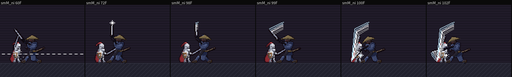

# 2026-11-26 資料集（design/）

黒い門番の「兜の目→触手」を予告の連撃にした。左から、予告（触手の先の小さな光、42F）→ 三本とも引いて止まり一本目だけ予兆（90F）→ 予兆から28Fで一撃目（116F）。

居合のおかしらの二の太刀（直したあと）。左から、一閃のあと前から頭上へ返す（60F）→ 頭上で止まって刀の先に合図（72F）→ 前へ打ち下ろす（98〜102F、当たり100F）。前は刀が背中側を回り、打ち下ろしの軌跡が「く」の字になっていた。

## したこと
- T048・T049：`DECISIONS.md` に「確定した組」の表と確定の4条件・順番を置いた。構えの点検に例外の表と組の指定と合否を、ステージの点検に主人公と誓いの間（赤い騎士のあと）を足した。構えの不合格は竜の1組だけ（差308／400、T061 で消える）、ステージは61組すべて合格。 あわせて T051：門の系統から外す4技を消し、連撃の間を `chars/gate.md` に書いて `moves.js` と一致を確かめた。確認待ちに OK をもらい、その中で順に灯る3技を予告の連撃（予告 → 引いて止まる → 予兆1回 → 予告どおり。一撃目まで28F）に作り直した。比較の道具に撮り始め（`gifStart`）を足した。push の前の点検役の指摘（原則の文の食いちがい4・名残1・動き2）を直した。
- T050：主人公を確定した（620c787）。立ち絵とモーション16枚に Ibuki の OK。こうげきは資料集の「光ってから6F」を、いったんゲームと同じ「光ってから28F」に直したが（追撃の受付8Fが光る前に始まっていた）、28Fは少し遅かったので、T081 で「光ってから20F、最後の6Fで斬り下ろす」にした。ゲームへの依頼【こうげきの光から当たりまでのフレーム】＝20 を書いた。`chars/hero.md` に【名前】＝値の表を書いた。赤い光のパリィの止まり18Fは、ゲームにすでに入っていた（12F＋【赤い一撃をパリィしたときに足すヒットストップフレーム】6F）。ステージの点検は主人公21組すべて合格。構えの点検は、主人公は敵の技を持たないので対象外。
- T052：門の系統（門番・黒い門番・門のぬし・暗い門のぬし）と関所2つ・大門の間2つを確定した（8e840b5）。確定の4条件：立ち絵はどの覚悟でも同じ姿、全モーションは黒い門番のひまなとき以外そろう（大ボスではないので持たない、と `chars/gate.md` に明記）、数値は `moves.js` と `chars/gate.md` が一致、点検は `audit_stance.py 門` 不合格0組・`audit_stage.py 門` 不合格0（関所〈黒い門番〉覚悟3 の輪郭の差14.0、大門の間9.3／例外9、開きかけ10.2・合図の余白14.5）。 確定の前に Ibuki の指摘で黒い門番の鎖の拍を直した。前は拍10F（数えられない）、拍の火花が予兆と同じ白・同じ場所、予兆が1拍目、当たり48Fは4拍目にも合っていなかった。いまは拍14・42・70F（28Fごと）、打つたびに床に光らない打ち跡が一つずつ残り、3つ目の上で予兆（70F）、4拍目98Fで来る。打ち跡は不ぞろいの黒い割れ目と鈍い灰のふちで、関所〈黒い門番〉覚悟3・4でも読める。比較ページに前と後、ステージの上での見え方を載せた。 push の前に点検役に決まりと照らさせた。打ち跡が敵のうしろ側に並んでいた（合図と鎖の来る道が逆側）のを主人公の側へ直し、gate.md の入れ子の崩れ・振り上げの時刻の書き方・確かめた記録の混入を直した。
- T053：影の組を確定した（fe8f4bc）。うそつきの影はフェイントのあと構えに戻らず、縮んで止まった低い姿勢のまま光って斬る（ふり→本物の当たり 92F→80F、二重フェイント 142F→118F、ふりから次の合図まではどれも10F）。影の剣士は前のまま戻る。確定の前の点検役が「先に会うのはうそつきの影なのに、戻る〈教える〉のがあとのモブ」という食いちがいを見つけ、Ibuki の指示で 2023-05-10「単調な坂は山登りにならない」に当てはめて、動きは変えずに理由を「うそつきの影＝山、影の剣士＝谷」に改めた。ほかに二重フェイントの2回目のふりのあとの間（8F→10F）、合図のあいだのゆらぎ（0.8→0.4）を直した。点検は `audit_stance.py 影` 不合格0組、`audit_stage.py 影` 5組すべて合格。比較の道具に `--from=<F>`（修正前も後も同じ時刻から撮る）を足した。
- T054：居合の組（居合の剣士・居合のおかしら）を確定した（89a7e32）。確定の4条件：立ち絵と覚悟の段4つ、全モーション（出現・ひまなとき・居合・返しの構え・返し斬り・二の太刀・パリィされ・ブレイク2枚・やられ・撃破）、数値は `chars/iai.md` に「数値」の節を足して `v2/iai.js` と一致（合図→当たりはどれも28F、二の太刀は合図 28・72F／当たり 56・100F・間44F、撃破はモブ96F・おかしら110F・閃光14F後）、点検は `audit_stance.py 居合` 不合格0組・`audit_stage.py 居合` 5組すべて合格。 確定の前に、二の太刀で一閃→頭上→打ち下ろしの刀が背中側を回っていたのを直した（頭上の角度に+2π。時刻は変えない）。Ibuki の OK のあと、push の前の点検役が同じ回り方を3つ（返し斬りの血振り、出現で笠を上げる腕、ひまなときに手を上げる腕）と、返し斬りの深く沈む動きが合図28Fをまたいで32Fまで続いていたこと、返し斬りの軌跡が弧だったこと（決まりは直線）を見つけたので直した（沈みは20→28Fで終える）。比較ページに4技の前と後を載せた。 `GAME_REQUESTS.md` の居合の節と照らし、「合図を笠の下の目に出す」に二の太刀の二撃目（頭上の刀の先）の但し書きを足し、ゲームに直接書かれている待つ長さを【居合の待つ長さ（短い）】＝12・（長い）＝30、【二の太刀の待つ長さ】＝18 として外に出す依頼を書いた。

## 決めたこと
- 反射神経に頼るゲームではない（Ibuki、軸）。反射神経が弱い人でもクリアできるようにする。前の当たりと次の合図を重ねない。`DECISIONS.md` の原則に書いた。
- 予告の連撃：攻撃する部位がいくつもある技（触手・目・指）は、予告（本番と同じ順・リズムの小さな光）→ 全部が引いて止まる → 予兆は一撃目だけ（28F）→ 予告どおり。続きの合図はみならいだけ。テンポは固定せず、気持ちのよいテンポを技ごとに決める。基準は28F。剣の連撃は一撃ごとの合図のまま。
- 黒い門番の兜の目→触手 28・28F、暗い門のぬしの背中の触手 28・28F、門の向こうの指 28・14F（タン・タタ）。門の向こうの指は、ぬしより手前に描く（主役は指。ぬしが隠れてよい）。
- 門の系統の確認待ち（門番の二連撃の関節、連撃の合図と間、合図を攻撃するもの）は済み。
- 主人公を確定した（2026-11-26）。こうげきは光ってから20F（28Fは少し遅かった。18Fか20Fのうち、読む時間を残せる20F）、赤い光のパリィの止まりはこのまま18F。主人公は覚悟で姿を変えず、パリィされ・ブレイク・ひまなときは持たない。
- 魔法とは何なのか、の設定をしっかり作り、まほうのモーションもそれに合わせる（すべてのディテールに意味を）。確定のあとの変更として T080 を切った。
- ステージの点検では、主人公は「芯の差」14以上で合格（白い鎧で体が明るく、暗い輪郭線が暗い背景に接するので輪郭の差は1〜10と低く出るが、目でははっきり読める）。合否は表に出す小数1桁の値で判定する（前は Python とページで判定がずれ、黒い門番 覚悟3 が 13.96 で片方だけ不合格になっていた）。
- 門の系統と関所・大門の間を確定した（2026-11-26 Ibuki）。関所〈黒い門番〉の輪郭の差14.0、大門の間の9.3 は、余裕を足さずこのまま。
- 影の組を確定した（2026-11-26 Ibuki）。うそつきの影は戻らない（山）、影の剣士は戻る（谷）。11-25 の理由「影の剣士で教え、中ボスで圧」は、出る順（フェイントはうそつきの影で先に教わる）と逆だったので改めた。【ふりのあとの間】は資料集の値で影の剣士22F・うそつきの影10F（ゲームの依頼に書いた）。
- 鎖の拍：拍は28F、数は床の打ち跡で数える（目の数は兜の目→触手の「来る回数」なので使わない）。打ち跡は暗いステージでも見えるように、形は1つずつ不ぞろいに（三角にそろえない）。
- 居合の組を確定した（2026-11-26 Ibuki）。二の太刀は待つ長さを揺らさない（18F。揺らすのは居合だけ）。腕と刀は体の前を通して動かす（背中側を回さない）。

## 困ったこと
- T048 の「`CLAUDE.md` から確定した組の節へ一行で案内する」は、今回触ってよい範囲（design/・自分のチケット・この日報）の外なので入れていない。改善案：次に CLAUDE.md を触るセッション（other）が、「決定事項（ゲーム）」の頭に「どの組が確定したかは `design/DECISIONS.md` の『確定した組』」と一行足す。
- 予告の連撃の続きの撃を「合図はみならいだけ」にしたので、ゲームの【速い連撃の二撃目以降の合図】（前の当たりから28Fより短い撃だけを隠す）とは決まり方がちがう（28Fちょうどの撃も隠す）。改善案：門の系統の確定後にゲームのチケットを切るとき、敵の撃に「予告の連撃」の印を持たせ、印のある撃の続きの合図を隠す、と書く。
- 黒い門番 覚悟3 の関所の輪郭の差は 14.0（13.96）で、合格ぎりぎり。改善案：門の系統の確定（T052）の前に、関所（黒い門番）の格子戸のふちを少し明るくする。
- 鎖の拍の拍の時刻（14・42・70F）が、兜の目→触手の予告と同じ。光る触手の先（3撃）と光らない床の打ち跡（1撃）で見分けられるので、そのままにした。改善案：ゲームで遊んで紛らわしければ、鎖の拍の1拍目を少し遅らせる（拍の間28Fは変えない）。
- DECISIONS.md の小鬼の拍が「石なげ小鬼の13F」と「モブ16F・おかしら13F」で食いちがう（今回より前から。点検役が見つけた）。改善案：小鬼の確定（T056）で正す。
- ゲームのチケットを切り直したセッションが、資料集の側のずれを2つ見つけた（`GAME_REQUESTS.md` の順に灯る技の14F が古い、黒い門番の撃破が `dg_down` と `dg_down2` の2枚に見える）。T092 で直した（仕様は変えず、予告の連撃の記述と、`dg_down` は土台という注に）。改善案：確定のときの点検で、`GAME_REQUESTS.md` のその組の節も照らす。
- 腕の角度の補間で、刀や腕が背中側を回るずれが、居合の組だけで4か所あった（目で見ないと気づきにくい）。改善案：`audit_stance.py` の横に、鍵と鍵のあいだで ua・fa・sw が 0（背中側）をまたぐ所を出す点検を足す（ほかの組の確定の前に走らせる）。
- 点検役が挙げたが直していないもの：返し斬りは、主人公が斬りかかって受け流される最中（14〜30F）に合図28Fが出る（資料集のカード）。ゲームでは斬りかかりと返しの時刻が別に決まるので、ゲームのチケット（居合）で、主人公の斬りかかりが終わってから光るかを確かめる。

## 決めてほしいこと
- **赤の系統の剣の連撃にも、構えの中で予告を入れるか**（Ibuki の案：二連撃・V字・逆の二連撃・つばめ返しのように数が同じ連撃を、構えのときの予告でリズムを変えて分ける）。案：A＝T058 で赤い騎士・本気の剣の連撃だけに「構えの予告」を入れる。予告の出し方は人ごとに変える（赤い騎士＝握り直しの力みの拍、本気＝霞や八相で切っ先が小さく光る）。門の系統と、ほかの組の剣の連撃は一撃ごとの合図のまま／B＝剣の連撃は全部、一撃ごとの合図のまま（おすすめ：A。同じ数の連撃が見た目だけちがう問題を、リズムの差で遊びの差に変えられる。全部を予告型にすると「予告を聞く遊び」だけになって差が消えるので、赤の系統だけにとどめる） → 決まった：A（赤い騎士・本気だけ）
- **赤の系統と三つ首で、順に灯る触手・指の技も予告の連撃にするか**（門の輪の触手・マントの触手の檻・見抜いたあとの触手・アーチの奥の指・背中の触手・三つ首の鳴いた数）。案：A＝その組の直しのチケット（T058・T059・T061）で予告の連撃にする／B＝14Fの順に灯る合図のまま（おすすめ：A。同じ14Fの重なり〈3つ目の合図と1つ目の当たり〉があり、「反射神経に頼らない」に合わない） → 決まった：A（予告型にする。ただし、ほかの予告の連撃と違うリズムにする）

## 次
- 影のゲームのチケット T007 を、資料集の場所（`chars/shade.md` の「数値」、`v2/shade.js` の技ID）を指す形に直してから取る（game のセッション）。
- 次に取れる design のチケットは T054（居合）。
- T080（主人公の魔法の設定）は、設定の案を出して Ibuki に決めてもらうところから。
- 主人公のゲームのチケット（いまの T004）を、資料集の場所（`chars/hero.md` の「数値」、`v2/heromv.js` の技ID）を指す形に切り直す（other のセッション）。【こうげきの斬り下ろしフレーム】＝6 を `DEF` に出す依頼もそこに入れる。
- 次に取れる design のチケットは T050（主人公を確定する）、T058・T059・T061（直し）、T063。
- 門の系統の確定（T052）は、表への記入と Ibuki の OK で済みになる。その前に、関所（黒い門番）の輪郭の差を見直す。
- 門の系統のゲームのチケットを、資料集の場所（`chars/gate.md`、`v2/moves.js` の技ID）を指す形で切り直す（other のセッション）。鎖の拍の依頼は `GAME_REQUESTS.md` の「新しい技（くらやみに関わるボス）」。
- 次に取れる design のチケットは T053（影）。
- 居合のゲームのチケット（いまの T010〜T012 は予定のまま）を、資料集の場所（`chars/iai.md` の「数値」、`v2/iai.js` の技ID）を指す形に切り直す（other のセッション）。技の時刻と待つ長さの依頼もそこに入れる。
- 次に取れる design のチケットは T055（からくり）。

