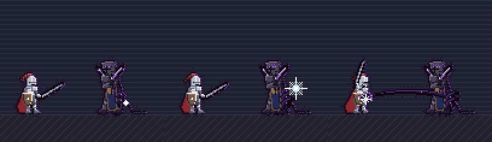

# 2026-11-26 資料集（design/）

黒い門番の「兜の目→触手」を予告の連撃にした。左から、予告（触手の先の小さな光、42F）→ 三本とも引いて止まり一本目だけ予兆（90F）→ 予兆から28Fで一撃目（116F）。

## したこと
- T048・T049：`DECISIONS.md` に「確定した組」の表と確定の4条件・順番を置いた。構えの点検に例外の表と組の指定と合否を、ステージの点検に主人公と誓いの間（赤い騎士のあと）を足した。構えの不合格は竜の1組だけ（差308／400、T061 で消える）、ステージは61組すべて合格。
- T051：門の系統から外す4技を消し（攻撃の技の数は 門番2＜黒い門番5＜門のぬし14＜暗い門のぬし20 のまま）、連撃の間を `chars/gate.md` に書いて `moves.js` と一致を確かめた。
- T051：確認待ち（門番の二連撃の関節、連撃の合図と間、合図を攻撃するもの）に OK をもらった。その中で、順に灯る3技を「予告 → 引いて止まる → 予兆1回 → 予告どおり」に作り直した（前は間14Fで、3つ目の合図が1つ目の当たりと同じフレームに重なっていた。いまは一撃目まで28F、28・28F、指は28・14F）。比較の道具に撮り始め（`gifStart`）を足した。push の前に点検役に決まりと照らさせ、数値のずれはなく、原則の文の食いちがい4つ・外した鞭の名残1つ・動き2つを直した。
- T050：主人公を確定した（620c787）。立ち絵とモーション16枚に Ibuki の OK。こうげきは資料集の「光ってから6F」をゲームと同じ「光ってから28F、最後の6Fで斬り下ろす」に直した（追撃の受付8Fが光る前に始まっていた）。`chars/hero.md` に【名前】＝値の表を書いた。赤い光のパリィの止まり18Fは、ゲームにすでに入っていた（12F＋【赤い一撃をパリィしたときに足すヒットストップフレーム】6F）。ステージの点検は主人公21組すべて合格。構えの点検は、主人公は敵の技を持たないので対象外。

## 決めたこと
- 反射神経に頼るゲームではない（Ibuki、軸）。反射神経が弱い人でもクリアできるようにする。前の当たりと次の合図を重ねない。`DECISIONS.md` の原則に書いた。
- 予告の連撃：攻撃する部位がいくつもある技（触手・目・指）は、予告（本番と同じ順・リズムの小さな光）→ 全部が引いて止まる → 予兆は一撃目だけ（28F）→ 予告どおり。続きの合図はみならいだけ。テンポは固定せず、気持ちのよいテンポを技ごとに決める。基準は28F。剣の連撃は一撃ごとの合図のまま。
- 黒い門番の兜の目→触手 28・28F、暗い門のぬしの背中の触手 28・28F、門の向こうの指 28・14F（タン・タタ）。門の向こうの指は、ぬしより手前に描く（主役は指。ぬしが隠れてよい）。
- 門の系統の確認待ち（門番の二連撃の関節、連撃の合図と間、合図を攻撃するもの）は済み。
- 主人公を確定した（2026-11-26）。こうげきはゲームにそろえて光ってから28F、赤い光のパリィの止まりはこのまま18F。主人公は覚悟で姿を変えず、パリィされ・ブレイク・ひまなときは持たない。
- 魔法とは何なのか、の設定をしっかり作り、まほうのモーションもそれに合わせる（すべてのディテールに意味を）。確定のあとの変更として T080 を切った。
- ステージの点検では、主人公は「芯の差」14以上で合格（白い鎧で体が明るく、暗い輪郭線が暗い背景に接するので輪郭の差は1〜10と低く出るが、目でははっきり読める）。合否は表に出す小数1桁の値で判定する（前は Python とページで判定がずれ、黒い門番 覚悟3 が 13.96 で片方だけ不合格になっていた）。

## 困ったこと
- T048 の「`CLAUDE.md` から確定した組の節へ一行で案内する」は、今回触ってよい範囲（design/・自分のチケット・この日報）の外なので入れていない。改善案：次に CLAUDE.md を触るセッション（other）が、「決定事項（ゲーム）」の頭に「どの組が確定したかは `design/DECISIONS.md` の『確定した組』」と一行足す。
- 予告の連撃の続きの撃を「合図はみならいだけ」にしたので、ゲームの【速い連撃の二撃目以降の合図】（前の当たりから28Fより短い撃だけを隠す）とは決まり方がちがう（28Fちょうどの撃も隠す）。改善案：門の系統の確定後にゲームのチケットを切るとき、敵の撃に「予告の連撃」の印を持たせ、印のある撃の続きの合図を隠す、と書く。
- 黒い門番 覚悟3 の関所の輪郭の差は 14.0（13.96）で、合格ぎりぎり。改善案：門の系統の確定（T052）の前に、関所（黒い門番）の格子戸のふちを少し明るくする。

## 決めてほしいこと
- **赤の系統の剣の連撃にも、構えの中で予告を入れるか**（Ibuki の案：二連撃・V字・逆の二連撃・つばめ返しのように数が同じ連撃を、構えのときの予告でリズムを変えて分ける）。案：A＝T058 で赤い騎士・本気の剣の連撃だけに「構えの予告」を入れる。予告の出し方は人ごとに変える（赤い騎士＝握り直しの力みの拍、本気＝霞や八相で切っ先が小さく光る）。門の系統と、ほかの組の剣の連撃は一撃ごとの合図のまま／B＝剣の連撃は全部、一撃ごとの合図のまま（おすすめ：A。同じ数の連撃が見た目だけちがう問題を、リズムの差で遊びの差に変えられる。全部を予告型にすると「予告を聞く遊び」だけになって差が消えるので、赤の系統だけにとどめる） → 決まった：A（赤い騎士・本気だけ）
- **赤の系統と三つ首で、順に灯る触手・指の技も予告の連撃にするか**（門の輪の触手・マントの触手の檻・見抜いたあとの触手・アーチの奥の指・背中の触手・三つ首の鳴いた数）。案：A＝その組の直しのチケット（T058・T059・T061）で予告の連撃にする／B＝14Fの順に灯る合図のまま（おすすめ：A。同じ14Fの重なり〈3つ目の合図と1つ目の当たり〉があり、「反射神経に頼らない」に合わない） → 決まった：A（予告型にする。ただし、ほかの予告の連撃と違うリズムにする）

## 次
- T080（主人公の魔法の設定）は、設定の案を出して Ibuki に決めてもらうところから。
- 主人公のゲームのチケット（いまの T004）を、資料集の場所（`chars/hero.md` の「数値」、`v2/heromv.js` の技ID）を指す形に切り直す（other のセッション）。【こうげきの斬り下ろしフレーム】＝6 を `DEF` に出す依頼もそこに入れる。
- 次に取れる design のチケットは T050（主人公を確定する）、T058・T059・T061（直し）、T063。
- 門の系統の確定（T052）は、表への記入と Ibuki の OK で済みになる。その前に、関所（黒い門番）の輪郭の差を見直す。
