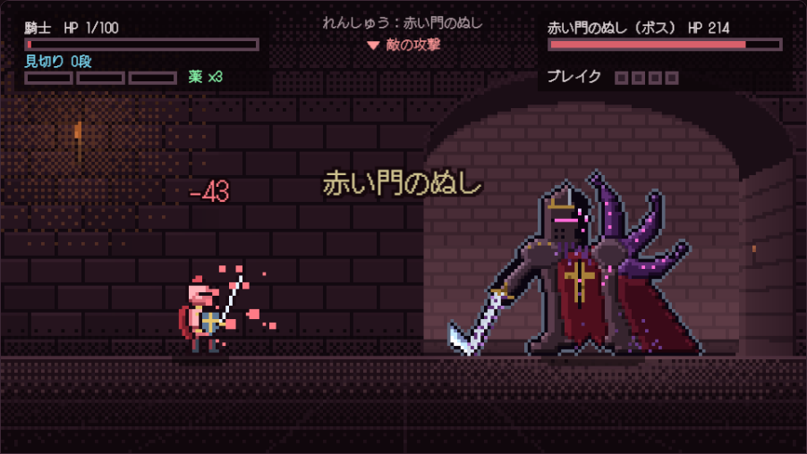
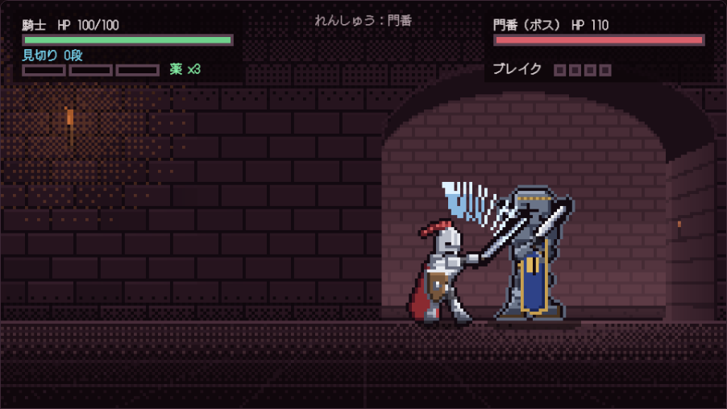
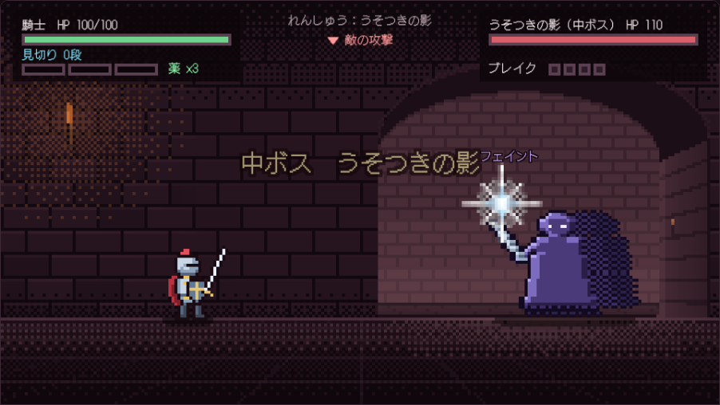

# 2026-11-26 ゲーム（js/）

赤い門のぬしが振り下ろして剣を引き戻すところ。前は剣先が床を24画素つきぬけていたが、いまは床の上で止まる。足元の影は前のとおり残る。

うそつきの影の二重フェイント（T007）。紫の輪 14F → ふり 42F → 紫 52F → ふり 80F → 白い合図 90F。撮ったのは94Fで、2回目のふりが終わり（「フェイント」の字）、構えに戻らずに本物の合図が光っている。当たりは118F。
`?new` の骨組みの主人公が、振りかぶったまま止まってから、最後の6Fで斬り下ろすところ（当たりの1F前）。刃の跡はうすい青。

## したこと
- T001「床と間合いをテストで見張る」を済みにし、節「床と間合い（全部の敵）」も済みにした。自動で戦わせるテストが、敵の絵だけを描いて見張る：床で切った絵に床より下の画素が0、切る前の沈みが【床に沈んでよい深さ】＝3画素以内、だれも振っていないときに主人公と重ならない。床の影・床をすべるたまり・合図の光は数えない。種1〜3の3通り（27体×2400Fずつ）で通った。許す深さを0にすると落ちるので、見張りが効いていることも確かめた。 ゲームの敵を床で切るようにした（`floorClip`）。影・たまり・合図の光は切らない。いまの敵で床につく部分の沈みは最大3画素（スライム・竜の尾）で、それが床の線で切れて見える。
- 破れていた3つを直した。赤い門のぬしと門のぬし第二形態の引き戻す剣先は24画素沈んでいたのを床で止めた。暴れ大イノシシの弾かれて回る絵は5画素沈んでいたのを、横倒しのときは絵の幅の半分だけ持ち上げて床に置くようにした。三つ首の竜の三本目の首の噛みつきは4画素から1画素にした（3本の首がねらう高さの差を6画素から3画素に）。当たりの時刻は変えていないので、手触りは変わらない。
- T004 を確定した資料集（`chars/hero.md`・依頼の「主人公のモーション」）を指す形に書き直して済みにした。こうげきは光から当たりが 28F → 20F（【こうげきの光から当たりまでのフレーム】）、斬り下ろしは 6F のまま `DEF` へ（【こうげきの斬り下ろしフレーム】）。`?new` のとき、主人公を資料集の骨組み（構え・剣28・はじまりの盾・こうげき3種）で描く（`js/24h-hero.js`）。残りは T082（まもる・かいふく・出現・やられ・撃破）と T083（まほう）に切った。
- `tools/ichimai.mjs` が Windows でページを読めなかった（道すじが `/C:/…` になる）のを直した。

- T006〜T009 を、確定した資料集（`chars/shade.md` の節、`v2/shade.js` の技ID）を指す形に切り直した。影の24の技IDが、どれかのチケットに入っていることを確かめた。撃破（`sh_down` `shM_down`）はどこにも無かったので T009 に足した。技の動き（T093）と `?new` なしの仕上げ（T094）は新しく切った。そのうえで T007 を済みにした。フェイントは、紫の輪から28F後にふり、ふりから【ふりのあとの間】（影の剣士22・うそつきの影10）で本物の合図になった。前は、輪の直後14Fでふり、ふりから合図まで30F＋pre だった。影の剣士に本物が2回続く（【連撃の間】44F）を足し、うそつきの影にもときどき赤を足した。時刻はすべて `chars/shade.md` の「数値」と一致した（ふり→本物は影の剣士92F・うそつきの影80F、二重フェイントは118F、本物が2回は42・86F）。27体×30000F（種3）戦わせて、こわれ方なし。
## 決めたこと
- 【床に沈んでよい深さ】は、ゲームの数値ではなくテストの物差しなので、`DEF` ではなく `tests/soak.mjs` の `SINK`（3画素）に置いた。

## 困ったこと
- 剣先は体と分けて見られないので、「剣先が床より上」は、沈みの3画素の中に含めて見ている。剣先が1〜3画素だけ床に刺さる絵は、まだ見のがす。改善案：`?new` の骨組み（`RIG`）は剣先の座標を持っているので、骨組みに移った敵から「剣先は床より上」を座標で見張る。
- 自動で戦わせるテストが、check.sh の中で約11秒から約24秒にのびた。改善案：いまは4Fごとに見て、床で切れているかと重なりは12Fごとにしている。まだ遅ければ、check.sh では敵ごとのフレーム数を減らし、夜通しの長い実行で拾う。
- 主人公との重なりは、だれも振っていないときしか見ていない。振っている最中は剣が当たるので、画素では体と剣を分けられない。改善案：上と同じく、骨組みに移った敵から体の輪郭だけで見る。

- 依頼の一覧の「影の剣士・うそつきの影」には「影の剣士にも『本物が2回続く』（今もある）」と書いてあったが、ゲームの影の剣士には無かった（T007 で入れた）。改善案：資料集のセッションが、次にこの節を触るときに「（今もある）」を消す。
- 影の剣士の技の出る割合が変わった。前は「ふり→本物」1／「一撃」2、いまは「ふり→本物」「一撃」「本物が2回続く」が1ずつで、一撃が減って連撃が増えた。改善案：遊んで重ければ、一撃をもう1つ足して前の割合に近づける。
## 決めてほしいこと
- なし

## 次
- T082（主人公のまもる・かいふく・出現・やられ・撃破）。いまの `?new` では、仮の構え（`HP_`）で止まった絵のまま。
- T002〜T005（待ちのない小さい直し）を順に取る。
- 「途中」の節を1つ済みまで持っていく（前の日報のとおり）。
