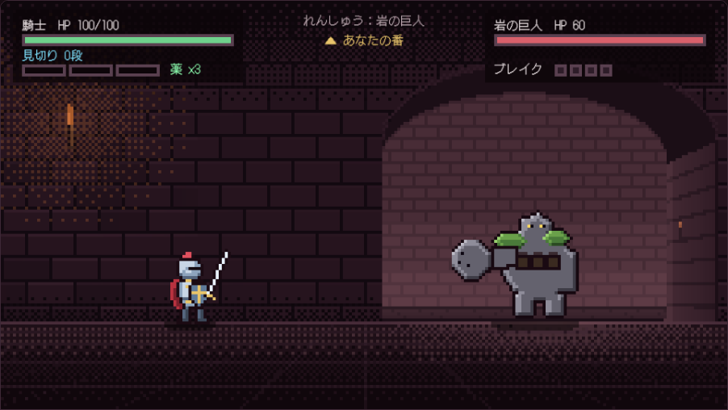

# 2026-11-26 チャット（決める・チケットを切る）

いまのゲームの岩の巨人。資料集にまだ何もない10体の一つで、確定は最後になる（T063〜T065）。

## したこと
- 資料集を組ごとに点検し、確定（立ち絵と覚悟の段・全モーション・数値・点検、と Ibuki の OK）までに足りないものを洗い出した。いまの20体は、7種類のモーションがほぼそろっている（欠けているのは突進イノシシのひまなときだけ）。止めているのは、外すと決めた技が7つ残っていること、11-25〜26 の決定が資料集に入っていないこと（うそつきの影は戻らない、つばめ返しと弐の居合の間、竜のひまなときとあごの触手）、確認待ち5件。
- 点検を走らせた：ステージの明るさは40組すべて合格（大門の間の輪郭の差9.3／下限9、誓いの間の合図の余白15.0／下限14 はぎりぎり）。構えの見分けで落ちたのは、竜の「三度の噛みつき」と「噛みつきから尾」の1組（差308／400）だけ。
- 資料集のセッション向けに、チケット32枚（T048〜T079、持ち場 design）を切った。組ごとに「直し → 確定」で、確定のチケットは Ibuki の OK と確定の表への記入で済みになる。専用ステージは、そこに出る組の確定に入れた。
- 決まったことを、依頼の一覧と、関係するゲームの予定チケット（T022・T027・T036・T042）に書いた。

## 決めたこと
- 突進イノシシにも、遊び心としてひまなときを作る。
- 竜は、怒りの「尾→噛みつき」を残し、「噛みつきから尾」を外す（構えの点検の不合格も消える）。
- 本気の参段は後回し。赤の系統の確定を止めない。
- 第二形態の水面の先読みの合図は白のまま。
- 構えの予告は、赤の系統の剣の連撃のうち赤い騎士・本気だけに入れる（T058）。
- 赤の系統と三つ首の順に灯る技も予告の連撃にする。ただし、ほかの予告の連撃とはリズムを変える（T059・T062）。

## 困ったこと
- 「確定した」を書く場所がまだなく、確定を待つゲームのセッションが何を見ればよいか分からない。改善案：T048 で DECISIONS.md に「確定した組」の表を置き、ゲームのチケットはこの表に日付が入ってから切る。
- 構えの点検が例外（残心に手を出す・打ち合い）も一緒に出すので、「通る」かどうかが目で見ないと分からない。改善案：T049 で例外の表を持たせ、合否を返すようにする。

## 決めてほしいこと
- なし

## 次
- 資料集のセッションは `node tools/tickets.mjs . design` で取る。最初は T048・T049（確定の表と点検の道具）と、待ちのない直し（T051・T058・T059・T061・T063）。
- 組が確定したら、このチャットでその組のゲームのチケットを、資料集の場所を指す形で切り直す（いまの T001〜T047 は予定表のまま）。
