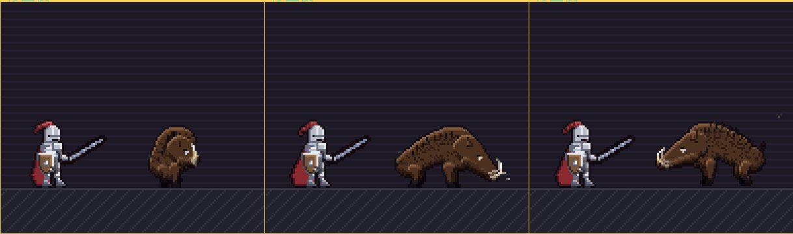

# 2026-11-27 資料集（design/）

突進イノシシのひまなとき。左から、尾の羽虫を追って回る（70F）→ 背を向けたまま止まる（108F）→ はっと向き直って白目をむく（122F）。

## したこと
- T057：突進イノシシ（モブ）にひまなとき `b_bored` を作った。尾にとまった羽虫（光らない、くすんだ色）を追って回り、回るたびに速くなる（向きを変え始める 26・50・68・82・92F、間は24→10F）。背を向けて止まり、116F に3Fで向き直って跳ね、白目をむいて震え、鼻を鳴らして立ち姿へ戻る（全176F）。大イノシシの「下をかいで、おびえる」と、若さと年寄りで対にした。向きを変えるために、drawBoar に体の真ん中を軸にした鏡写し（`fs`）を足した。fs=1 の絵は変わらない（点検役が1500姿勢で画素を比べて差0）。
- `chars/boar.md` に数値の節を書いた（構えで止まる16F、後ずさる 0・14・22F、合図から当たり 28・35・41F／大イノシシの遠い42F、溜め突進は後ずさる＋地をかく30F＋止まる16F、当たったあと・壁に激突・ひまなとき・撃破の時刻）。
- 構えてから合図までを資料集にそろえる依頼を `GAME_REQUESTS.md` に書いた（【イノシシの後ずさる時間】・【イノシシの構えで止まる時間】＝16・【溜め突進の地をかく時間】＝30。ゲームの固定36F・40Fをやめる）。
- 点検：`audit_stance.py イノシシ` 不合格0組、`audit_stage.py イノシシ` 5組すべて合格。push の前の点検役の指摘を直した：鏡写しで目の黒目が白目に上書きされて消えていた（白い点だけになり、合図の白にまぎれる）、牙の陰と鼻息の画素の向き、羽虫を尾の付け根から置く、文の「ずっと動いている」（背を向けて止まる所がある）・「構え直す」（この組の構えは突進の構え）・震える時刻のずれ、数値の節に混ざった確かめた記録と依頼の経緯。

## 決めたこと
- 突進イノシシのひまなときは「尾を追って回る」（Ibuki）。
- 構えてから合図までは資料集にそろえる：後ずさる時間＋構えで止まる16F（Ibuki）。「止まったら来る」が間合いに関係なく同じになる。
- 突進イノシシのひまなときは、羽虫に気がそれている間（0〜116F）は白目をむかない（目の下の白い点が涙に見えたため。ほかの技の目はそのまま）。向き直ってから白目をむく（Ibuki）。
- 主人公・居合・からくり・小鬼のゲームのチケットは、まとめて一つのセッションで切り直す（Ibuki、B）。

## 困ったこと
- 鏡写しの式は恒等でも、`e[0]+1` のように片側だけに置く画素は向きを変えると崩れる（目の黒目が消えた）。改善案：ほかの敵に鏡写しを足すときは、`±1` で置く画素を `sg` で書き、向きを変えたコマを拡大して目と牙を見る。
- ゲームでは、ひまなときの背を向けた途中で敵の番が来ると、構えへ飛ぶおそれがある（点検役の推測）。改善案：依頼に「向き直って（3F）から後ずさる」と書いた。ゲームのチケットで確かめる。

## 決めてほしいこと
- **イノシシの組を確定してよいか**（資料集 `design/v2/bible2.html` の突進イノシシ・暴れ大イノシシ）。案：A＝確定する／B＝直してから（おすすめ：A。確定の4条件はそろい、点検も合格）

## 次
- Ibuki の OK が出たら、`DECISIONS.md` の「確定した組」にイノシシを書き、T057 を済みにする。
- 主人公・居合・からくり・小鬼のゲームのチケットを、資料集の節と技IDを指す形に切り直す（このセッションで続けて行う）。
