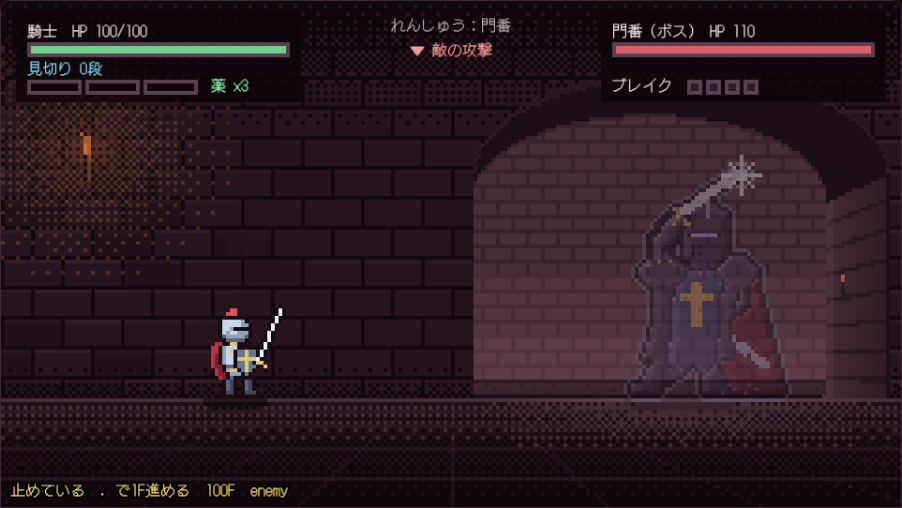

# 日報

2023-06-26「日報のすすめ」・2022-11-28「チームの情報共有」にならう。セッションが終わるときに書き、次のセッションは始めに直近の日報を読む。Ibuki はこのフォルダと `node tools/handan.mjs` を見れば、全体と自分の判断待ちが分かる。

## 書き方
- ファイルは `日付_持ち場.md`（持ち場は `game`＝js/・`design`＝資料集・`other`）。同じ日に同じ持ち場で2回目なら、同じファイルに書き足す。持ち場ごとにファイルを分けるのは、並んで作業するセッションが同じファイルをいじらないため（2023-12-12「多くの人がファイルをいじる方法」）。
- 今日の1枚は `node tools/ichimai.mjs nippo/日付_持ち場.png / "場面を作るJS"` で撮る。その日の変化がいちばん分かる画面にする。
- 見出しは次の5つをこの順に。`node tests/nippo.mjs` が形を見る。
  - **したこと**：1〜5個。コミットの言い直しではなく、何がどう良くなったかを書く。
  - **決めたこと**：その日に決まったこと（なければ「なし」）。
  - **困ったこと**：ダメ出しだけでなく、必ず改善案を添える（2023-01-11「思ったことはすぐに言え」）。
  - **決めてほしいこと**：Ibuki に決めてほしいこと。1行に1つ、「案：A／B（おすすめ：A）」を必ずつける。決まったら行の末尾に「→ 決まった：A」を足す。
  - **次**：次にやること。

```
# 2026-11-25 ゲーム（js/）

1枚の説明を1行。

## したこと
- …
## 決めたこと
- なし
## 困ったこと
- …。改善案：…
## 決めてほしいこと
- **…にするか** 案：A／B（おすすめ：A。理由…）
## 次
- …
```
